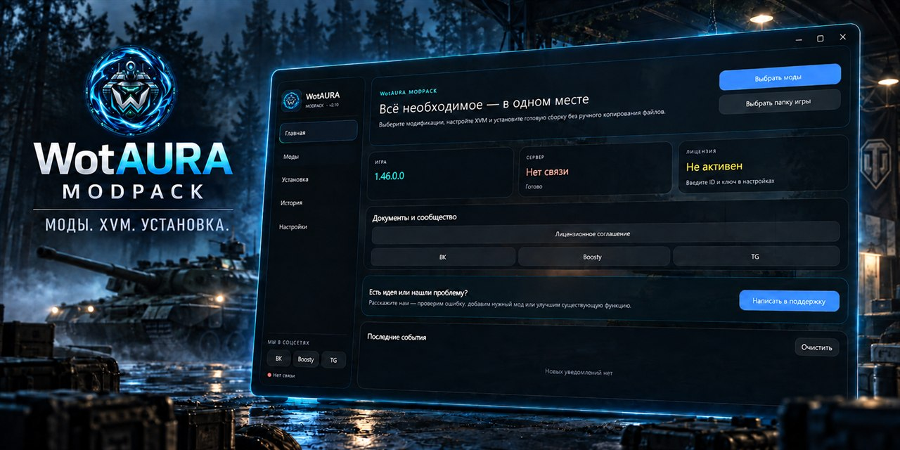

# WotAURA ModPack

Модпак для игры «Мир танков»: удобный выбор и установка модификаций.

## Скачать

**[Скачать WotAURA 2.3.5](https://github.com/lyprot99/WotAURA-ModPack/releases)**

Программа распространяется одним файлом — `WotAURA.exe`.

## Как установить

1. Скачайте `WotAURA.exe` со страницы Releases.
2. Перед запуском установки закройте игру.
3. Запустите WotAURA и укажите папку с игрой.
4. Выберите нужные моды и режим установки.
5. При желании поддержите развитие проекта на Boosty и вступите в закрытое сообщество WotAURA.

Перед изменением игровых файлов установщик сохраняет необходимые данные для восстановления.

Скачивайте WotAURA ModPack только из этого репозитория.

## Поддержка

Сообщить об ошибке или предложить новый мод можно через раздел «Поддержка» в WotAURA либо через официальные сообщества [ВКонтакте](https://vk.ru/wotauramodpack) и [Telegram](https://t.me/WotAURAModPack).

Текущая версия: **2.3.5**.
