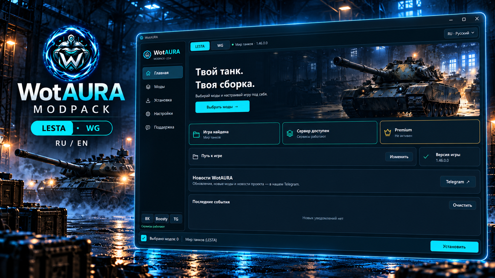

# WotAURA ModPack

Модпак для «Мира танков» LESTA и World of Tanks WG: выбор, установка и обновление модификаций в одном приложении.

## Скачать

**[Скачать WotAURA 2.4.7](https://github.com/lyprot99/WotAURA-ModPack/releases/latest)** · [Что нового — RU](news/2.4.7.ru.md) · [Release news — EN](news/2.4.7.en.md)

Программа распространяется одним файлом — `WotAURA.exe`.

При первом запуске программа размещается в `%LOCALAPPDATA%/WotAURA/application` и создаёт ярлык на рабочем столе. Обновления устанавливает отдельный обновлятор с проверкой размера и контрольной суммы; при неудачной проверке запуска восстанавливается предыдущая версия.

Переключатель **LESTA | WG** расположен под логотипом. Для каждой игры используются отдельные каталоги и файлы. Доступны русский и английский интерфейсы; язык выбирается в боковой панели.

Все текущие собственные Premium-моды WotAURA доступны для поддерживаемой версии. Бесплатные моды не требуют Premium-подписки.

Модпак проверяет выбранную игру и её поддерживаемую версию. При обязательном обновлении работа прежней версии ограничивается. Закрытие во время критических операций ожидает безопасного завершения или остановки и отката установки.

Поддерживаются Windows 10 и Windows 11 (64-битные).

## Как установить

1. Скачайте `WotAURA.exe` со страницы Releases.
2. Перед запуском установки закройте игру.
3. Запустите WotAURA, выберите LESTA или WG и укажите папку соответствующей игры.
4. Выберите нужные моды и режим установки.
5. Для Premium-функций оформите подходящий тариф на [Boosty](https://boosty.to/wotauramodpack), получите доступ к приватной Telegram-группе и запросите ключ у [бота WotAURA](https://t.me/WotAURA_Key_bot). Перед оплатой проверьте условия тарифа и совместимость выбранных модов.

Перед изменением игровых файлов установщик сохраняет необходимые данные для восстановления. Это не заменяет вашу личную резервную копию.

Скачивайте WotAURA ModPack только из этого репозитория. WotAURA — независимый проект, не официальный продукт LESTA или Wargaming.

## Документы / Documents

| | Русский | English |
|---|---|---|
| Лицензионное соглашение / License agreement | [RU](LICENSE) | [EN](LICENSE.en.md) |
| Условия подписки / Subscription terms | [RU](SUBSCRIPTION_TERMS.ru.md) | [EN](SUBSCRIPTION_TERMS.en.md) |

## Поддержка

Если возникла ошибка установки, работы мода или активации, откройте **«Поддержка»** в модпаке. Укажите игру, название мода и описание проблемы; по возможности приложите скриншот. **Не отправляйте лицензионный ключ.** Дополнительный контакт: [ВКонтакте](https://vk.ru/wotauramodpack). Новости: [Telegram](https://t.me/WotAURAModPack).

## English

WotAURA supports LESTA's Mir Tankov and Wargaming's World of Tanks, with separate mod catalogs and files. Choose **LESTA | WG** below the logo and select Russian or English in the sidebar.

All current original WotAURA Premium mods are available for the supported WG version, including Tundra and Shoot-through. Some free third-party WG mods are still being updated or adapted; unavailable cards are clearly marked. WG Sounds are not available yet. Free mods do not require a Premium subscription.

Download `WotAURA.exe` from [Releases](https://github.com/lyprot99/WotAURA-ModPack/releases/latest), select your game and its folder, close the game and install your chosen mods. Windows 10/11, 64-bit. Automatic updates verify the download and application startup, restoring the previous version if verification fails. Older versions may be blocked when an update is mandatory.

Before subscribing on [Boosty](https://boosty.to/wotauramodpack), review the plan, [subscription terms](SUBSCRIPTION_TERMS.en.md) and mod compatibility. For issues, open **Support** in the modpack and include the game, mod name and a description. **Do not include your license key.**

При ошибке установки автоматически отправляется ограниченный технический отчёт: этап, выбранные моды, причина сбоя и результат восстановления. Лицензионные ключи и секреты доступа в отчёт не включаются. Отчёт не означает успешную установку.

Installation failures automatically send a bounded technical report: installation stage, selected mods, error details and recovery outcome. License keys and access credentials are excluded. An error report does not count as a successful installation.

Текущая версия: **2.4.7**.
